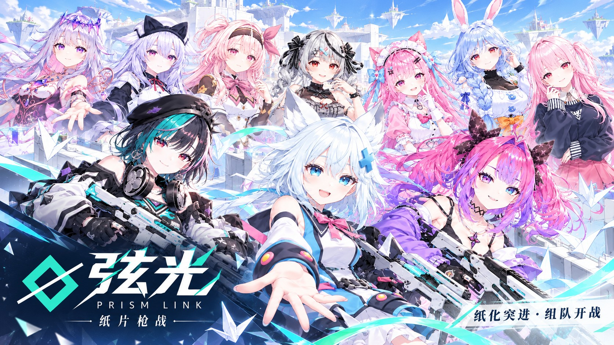

# 弦光 PRISM / LINK · 纸片枪战



一款跑在浏览器里的二次元第三 / 第一人称射击游戏，用 Three.js 和 VRM 角色制作。可以单机打训练场、和 AI 打 4V4 团队竞技，也能创建房间和朋友联机。另外附带一个 Electron 打包的 Windows 桌面版。

> 个人兴趣项目，不盈利。

## 功能一览

**角色**
- 10 位引航者，部分有多套外观。
- 每个角色有专属的出场动画和待机动作（在 Blender 里制作）。
- 角色带二次元描边，身高统一到相近范围。

**战斗**
- 第三人称越肩视角 / 第一人称（V 切换）。
- 按住 Alt 进入临时自由视角，环绕查看自己的角色。
- 8 把枪：突击步枪、冲锋枪、轻机枪、狙击枪、手枪、左轮、霰弹枪、火箭筒。
- 每把枪可以装配件（瞄具、枪口、护木 / 枪管、握把），有专属换弹动画。
- 技能：纸化（C / Ctrl，侧面几乎打不中）、纸鹤突进（E）、墨水炸弹（Q）。

**模式与地图**
- 训练模式：晴空露台、折光靶场。
- 竞技模式（4V4 团队竞技）：棱镜中枢、雨夜街区。AI 难度可选低 / 中 / 高。

**联机**
- WebSocket 房间：创建、搜索、加入，房主按 Enter 开始，空位由 AI 补上。
- 同步位置与动作、换弹动画、武器与配件、开火、伤害、击杀、比分、天气。

**大厅**
- 启动动画 → 海报 + 资源预加载 → 大厅。
- 引航者页可以选外观、查看技能和档案；还有武器配件页、商城页、设置、表情轮盘和右下角桌宠。

## 快速开始

### 浏览器版

1. 电脑上需要装有 **Node.js** 或 **Python** 其中一个。
2. 双击根目录的 `start.bat`，浏览器会自动打开 http://localhost:5173/index.html 。
3. 玩的时候不要关掉弹出的黑色窗口。

不用 bat 的话，在项目根目录运行下面任意一条命令：

```bash
npx --yes http-server . -p 5173 -c-1 -s
# 或
python -m http.server 5173
```

不能直接双击 `index.html` 用 `file://` 打开，模型会加载失败。

### 联机

1. 启动联机服务器：双击 `server/启动联机服务器.bat`，或者运行下面的命令（同样保持窗口开着）：

   ```bash
   npm --prefix server install --omit=dev
   node server/server.js 8787
   ```

2. 游戏里依次点：大厅 →「选择模式」→ 竞技模式 →「组队联机」→ 开始。
3. 房主选「创建房间」，其他人选「寻找房间」→ 加入。
4. 同一台电脑测试时，服务器地址用 `ws://localhost:8787`。
5. 局域网朋友要填房主的 IPv4 地址，例如 `ws://192.168.1.20:8787`，并且房主的 Windows 防火墙要放行 TCP 8787。
6. 想确认服务器是否启动，可以访问 http://localhost:8787/ ，它会返回在线人数和房间数（JSON）。

### Windows 桌面版

见 [docs/windows-packaging.md](docs/windows-packaging.md)。

- 桌面版用 `tools/electron/` 作为启动器，会自动开一个本机联机服务器。
- 游戏文件放在 `resources/app/game/`，`tools/electron/update.bat` 可以把本项目同步进去。

## 默认按键

全部按键都可以在设置里改。

| 按键 | 作用 |
|---|---|
| WASD / 空格 / 左 Shift | 移动 / 跳跃 / 冲刺 |
| 鼠标左键 / 右键（按住） | 射击 / 瞄准 |
| R | 换弹 |
| C 或 左 Ctrl（按住） | 纸化 |
| E / Q | 纸鹤突进 / 墨水炸弹 |
| 1–8 / 滚轮 | 切换武器 |
| V | 第一 / 第三人称 |
| Alt（按住） | 自由视角：鼠标环绕、滚轮缩放，按住期间其他操作无效 |
| X（按住） | 表情轮盘 |
| Tab | 计分板 |
| Enter | 房主在等待阶段开始比赛 |
| Esc | 菜单 |

## 目录结构

```text
index.html                 页面骨架：启动动画、大厅、HUD
*.css                      lobby / lobby-pages（大厅）、hud / hud-skin（局内）、menu（设置）、style
src/                       游戏代码（原生 ES Module，不需要构建）
server/                    联机服务器（Node.js + ws）
vendor/                    Three.js、three-vrm 等本地依赖（通过 importmap 引入）
Asset/                     角色、动作、枪械、场景、UI、音效
tools/                     制作工具：Blender 转换 / 动画脚本、动作烘焙、枪械组装、Electron 启动器
docs/                      打包等文档
```

更详细的代码说明、改动约定和测试方法见 **[AGENTS.md](AGENTS.md)**。用 AI 编程助手（Claude Code、Codex、Cursor 等）参与开发时，先让它读这份文件。

## 添加一个角色

1. **准备模型**：
   - VRM 模型直接放进 `Asset/Character/VRM/`。
   - MMD（PMX）模型先用 `tools/vrm/` 的 Blender 脚本转成 VRM，具体见 AGENTS.md 的「角色管线」一节。
2. **登记角色**：在 `src/config.js` 的 `CHARACTERS` 里加一条，填写 `id`、`name`、`file`、`face`（头像），同一角色的多套外观要用相同的 `persona`。
3. **加进引航者列表**：在 `src/lobby.js` 的 `NAVIGATORS` 里加一位引航者（名字、头像、`skins` 外观列表）。
4. **可选内容**：
   - 出场 / 待机动画：编辑 `tools/anim/anim_defs.py`，在 Blender 里重新导出 `Asset/Animation/nav_show.json`。
   - 桌宠台词：`src/pet.js` 的 `PROFILES`。

## 联机架构与已知限制

- 服务器只负责房间、分队和消息转发，不运行权威战斗模拟。
- 每个客户端计算自己的移动；命中由攻击方判定后通知被击中的一方；房主运行 AI 并广播比分。
- 房主中途离开后，暂时不能把房主身份转给别人继续对局。
- 房间信息只保存在服务器内存里，服务器重启后需要重新建房。
- 没有身份认证、反作弊和断线重连。跨公网联机需要自己部署可访问的服务器，或配置端口映射 / 反向代理。

## 素材与授权

代码以外的素材来源和授权要求记录在 [Asset/LICENSES.md](Asset/LICENSES.md)，第三方库的许可证随 `vendor/` 保留。

**重要**：部分角色模型（Booth 购买的模型、MMD 模型）和 Infima Games 枪械是第三方素材，授权一般**不允许把模型文件公开再分发**。如果仓库是公开的，请先确认每个素材的使用条款，必要时把这些文件排除在仓库外，只保留获取方式说明。
